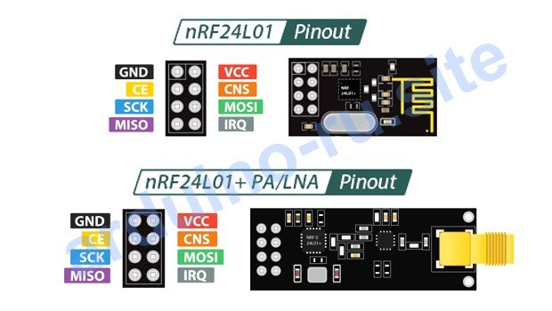
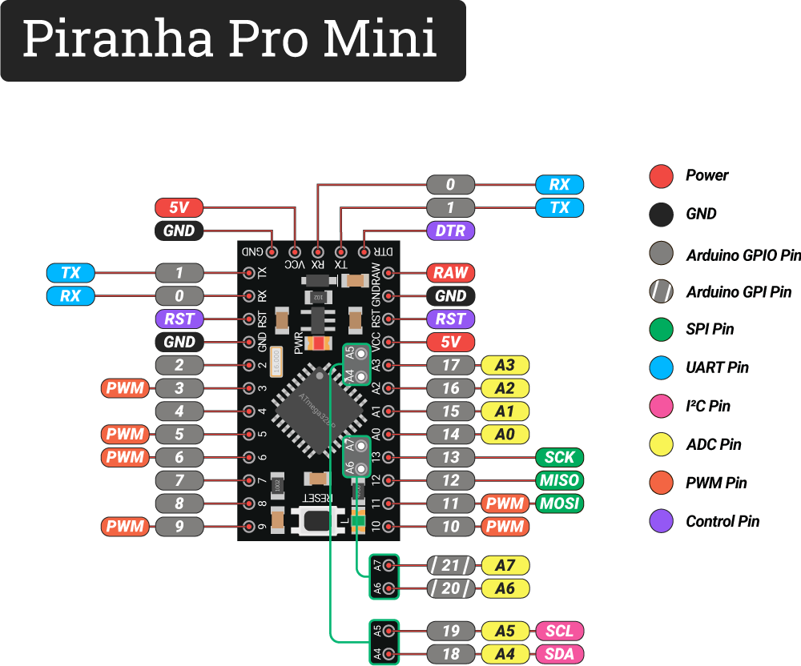
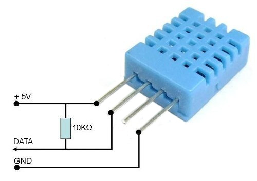
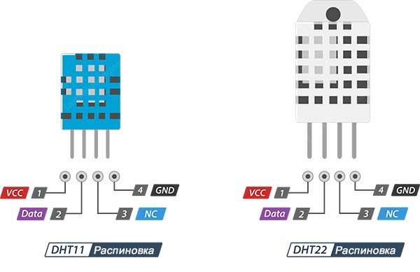
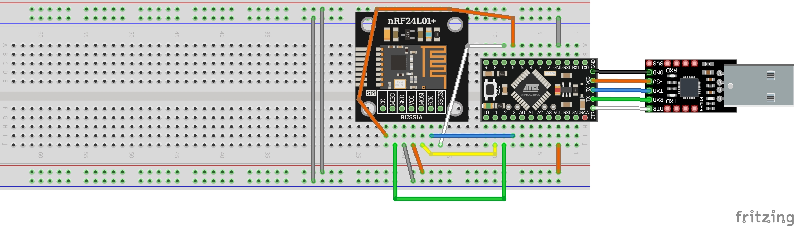

## [KvizzyVid17base - Передача показаний](#)

## [температуры, влажности, уровня воды](#)

### Как работать с nrf24l01 через PiranhaProMini

#### [Подключение nrf24l01](#)





Модуль nRF24L01 общается по интерфейсу SPI, поэтому нужно соединить соответствующие пины по следующей схеме:

```
VCC модуля              → 3.3 В   на PiranhaProMini;
GND модуля              → GND     на PiranhaProMini;
CE (Chip Enable) модуля → GPIO6   оранжевый;
CSN (Chip Select Not, активен низкий уровень для SPI) модуля 
                        → GPIO7   белый;
MISO модуля             → GPIO12  зеленый;
MOSI модуля             → GPIO11  желтый;
SCK модуля              → GPIO13  синий;
```

Конденсатор. Для стабильной работы параллельно пинам VCC и GND модуля nRF24L01 желательно поставить конденсатор ёмкостью около 10 мкФ. Он сгладит скачки напряжения и уменьшит помехи.


***Ключевой момент:***  адрес трубы (`openWritingPipe` и `openReadingPipe`) должен совпадать на обоих модулях. Это главное условие для успешной связи.

#### Решение частых проблем

- ***Не работает связь.*** Проверьте правильность физического подключения. Убедитесь, что адреса (трубы) на передатчике и приёмнике совпадают. Проверьте стабильность питания модуля.

- ***Потери пакетов.*** Радиотракт nRF24L01 чувствителен к помехам. Попробуйте использовать экранированный кабель или обернуть плату модуля фольгой (не изолентой!). Также можно поэкспериментировать со скоростью передачи данных и уровнем мощности (PA).

- ***Нестабильная работа при нескольких модулях.*** Иногда проблема в том, что при одновременном обмене данными с несколькими устройствами возникает конфликт. Попробуйте изменить адреса труб или отключить автоматическую отправку подтверждений (`autoAck`).

#### [Подключение датчика DHT11 к Ардуино](https://robotclass.ru/tutorials/arduino-dht/?ysclid=mvtqec8crx792409395)





Характеристики датчика

```
напряжение питания и I/O:              от 3,3 до 5,5 В;
тип датчика влажности:                 резистивный;
диапазон измерения влажности:          от 20% до 90%;
погрешность при измерении влажности:   5%;
тип датчика температуры:               NTC термистор;
диапазон измерения температуры:        от 0°C до 50°C;
погрешность при измерении температуры: 2%;
частота опроса:                        не более 1 Гц (1 раз в сек.);
время отклика при измерении влажности: 10 с.
```

Кроме DHT-11, существует множество аналогичных датчиков, которые отличаются точностью, энергопотреблением, интерфейсом. 

> ***Например, у датчика DHT22 диапазон измерений влажности составляет от 0 до 100%, а температуры от -40 до 125°C.***

#### Общая схема



###  Как сделать устойчивую связь в проекте на ардуино для nrf24l01+

Для устойчивой связи с модулем nRF24L01+ в проекте на Arduino я рекомендую не только написать правильный код, но и уделить внимание аппаратной части. 

#### Аппаратная часть

- Питание. Модуль работает от 3,3 В. Никогда не подавайте на него 5 В — это гарантированно выведет модуль из строя. 

- Конденсатор. Обязательно припаяйте электролитический конденсатор (10–100 мкФ) между выводами VCC и GND модуля. Это стабилизирует питание и снижает помехи. Соблюдайте полярность. 

- Заземление. Подключите резистор 10 кОм между выводом 7 (IRQ) модуля и землёй. Это предотвратит ложные прерывания. 

- Защита от помех. Если связь нестабильна, обмотайте плату модуля малярным скотчем, а поверх — несколькими витками фольги (например, от конфеты). Это экранирует радиотрак и снижает влияние внешних помех. 

- Канал связи. У модуля 128 каналов в диапазоне 2,4 ГГц. Если рядом работают другие устройства (Wi-Fi, Bluetooth, СВЧ), связь может «сыпаться». Попробуйте сменить канал. 

#### Код для устойчивой связи

Пример скетча, который реализует автоматическую повторную передачу (ARQ — Automatic Repeat Request) при потере пакета. Это и есть механизм устойчивой связи.

```
// Передатчик (Sender)

#include <SPI.h>
#include <RF24.h>

// Адреса приёмников
const uint64_t pipe_rx = {0x00, 0x01}; // Пример адресов — задайте свои [6](https://xn--18-6kcdusowgbt1a4b.xn--p1ai/nrf24l01-%D0%B0%D1%80%D0%B4%D1%83%D0%B8%D0%BD%D0%BE/)

RF24 radioTx(9, 10); // Объект радио, CE=9, CSN=10

void setup() 
{
  Serial.begin(115200);
  radioTx.begin();
  radioTx.setChannel(0x55); // Установите желаемый канал
  radioTx.enableDynamicPayloads(); // Разрешите динамические полезные нагрузки — это повышает устойчивость
}

void loop() 
{
  // Данные toSend — ваши данные (например, с датчика)
  uint8_t payload = {static_cast<uint8_t>(toSend % 256)}; // Пример: передаём младший байт 

  if (radioTx.write(payload, sizeof(payload))) 
  {
    Serial.println("Отправлено");
    radioTx.flush(); // Отправляем пакет сразу
  } 
  else 
  {
    Serial.println("Ошибка передачи или нет свободного слота");
    delay(100); // Пауза перед повторной попыткой
    radioTx.begin(); // Перезапускаем передачу
    radioTx.setChannel(0x55);
    radioTx.enableDynamicPayloads();
  }
}
```

```
// Приёмник (Receiver)
#include <SPI.h>
#include <RF24.h>

// Адреса приёмников
const uint64_t pipe_rx = {0x00, 0x01}; [6](https://xn--18-6kcdusowgbt1a4b.xn--p1ai/nrf24l01-%D0%B0%D1%80%D0%B4%D1%83%D0%B8%D0%BD%D0%BE/)

RF24 radioRx(9, 10); // Объект радио, CE=9, CSN=10

void setup() 
{
  Serial.begin(9600);
  radioRx.begin();
  radioRx.setChannel(0x55); // Тот же канал, что и у передатчика
}

void loop() 
{
  if (radioRx.available()) {
    uint8_t payload;
    if (radioRx.read(payload, sizeof(payload))) 
    {
      Serial.println("Получено: " + String(payload) + "," + String(payload));
    } 
    else 
    {
      Serial.println("Ошибка чтения или нет пакета");
    }
  }
}
```
#### Как усилить устойчивость

* **ARQ.** В коде выше реализована автоматическая повторная передача при неудаче. Это базовый механизм для устойчивой связи.

* **Динамические полезные нагрузки (dynamic payloads).** Библиотека RF24 позволяет менять структуру передаваемых данных «на лету». Это повышает устойчивость, так как приёмник может обрабатывать разные форматы пакетов без перекомпиляции кода.

* **Проверка CRC.** Библиотека RF24 по умолчанию проверяет целостность пакетов (CRC). Это отсекает искажённые данные, что тоже напрямую влияет на стабильность.

* **Мониторинг.** Добавьте в код логирование или визуализацию (например, мигание светодиода) при потере пакета — это поможет понять, на каком этапе связь прерывается.

#### Несколько советов

* Перед запуском проверьте связь простым скетчем (без передачи данных), чтобы убедиться в правильности подключения и настройки адресов.

* Избегайте передачи больших объёмов данных в одном пакете — это увеличивает риск переполнения буфера.

* Если связь всё равно нестабильна, попробуйте сменить канал или проверить наличие сильных помех в зоне работы.

#### [Как работает беспроводной модуль nRF24L01+ и его подключение к Arduino](https://wiki.alashed.kz/arduino/nrf24l01-arduino-wireless-communication/index.html)

#### [Подключение модуля nRF24L01+ к Arduino — соединяем две arduino по радиоканалу](https://micro-pi.ru/подключение-модуля-nrf24l01-к-arduino/?ysclid=mwx71wig3214090042)

#### [Обзор радио модуля NRF24L01+](https://robotchip.ru/obzor-radio-modulya-nrf24l01/?ysclid=mwx759045254062728)

#### [Range Extender на NRF24L01+PA+LNA: обмен текстовыми сообщениями между устройствами там, где нет сотовой связи](https://habr.com/ru/companies/ruvds/articles/792922/?ysclid=mwx772wy6903327084)

#### [Урок 26.4 Соединяем две arduino по радиоканалу через nRF24L01+](https://lesson.iarduino.ru/page/urok-26-4-soedinyaem-dve-arduino-po-radiokanalu-cherez-nrf24l01/?ysclid=mwx79zlr7202928101)

#### [Arduino и NRF24L01 в одной плате. Первое знакомство](https://habr.com/ru/articles/575216/)

### [Как определить уровень сигнала от nrf24l01]

Определить уровень принимаемого сигнала с nRF24L01 можно несколькими способами. Но модуль сам по себе не выдаёт абсолютное значение мощности в ваттах — он показывает, превышает ли принятый сигнал порог в -64 дБм. 

[microsin.net](https://microsin.net/adminstuff/hardware/nrf24l01-single-chip-24ghz-transceiver.html?ysclid=mwx83fk93577325116)

[aterlux.ru](https://aterlux.ru/article/nrf24l01p?ysclid=mwx85nrs5980543267)

#### Способ 1. testCarrier()

Это самый простой вариант, если вам нужно лишь проверить, есть ли на канале какой-либо сигнал (например, от другого устройства или помехи). Функция возвращает true, если уровень сигнала >= -64 дБм, и false, если слабее. 

Как использовать: вызовите radio.testCarrier() в коде на приёмнике. Это полезно для динамического выбора канала или поиска помех. 

#### Способ 2. testRPD()

Эта функция тоже проверяет, превышает ли уровень сигнала тот же порог (-64 дБм), но она доступна только на модификациях с плюсом (например, nRF24L01+). На чистом nRF24L01 она не сработает. 

Как использовать: radio.testRPD(). Если результат true — сигнал достаточно сильный, false — слабый или его нет. 

#### Способ 3. Чтение регистра RPD

Если вам нужен более детальный разбор (например, для построения графика уровня сигнала в разных условиях), можно напрямую работать с регистром RPD (регистр 0x09). Младший бит (бит 0) этого регистра устанавливается в 1, если в режиме приёма уровень сигнала превышает -64 дБм. Если сигнал слабее, бит остаётся равным 0. 

Как реализовать: после того как вы перевели модуль в режим приёма (например, в обработчике radio.startListening() или при появлении данных в буфере), прочитайте содержимое регистра RPD через SPI-команды. 

#### Важные нюансы

Порог срабатывания. Функция testRPD() и проверка бита RPD срабатывают именно на отметке -64 дБм. Сигнал слабее этого значения системой не фиксируется. 

Не путайте с мощностью передачи. Не пытайтесь использовать getPALevel() — эта функция относится к настройке выходной мощности передатчика (PA), а не к уровню принимаемого сигнала. 

