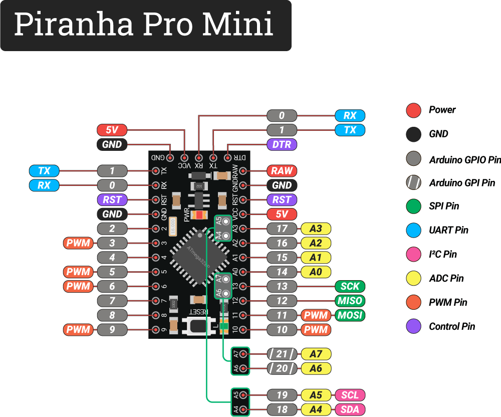
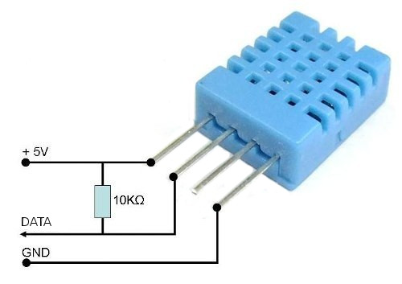
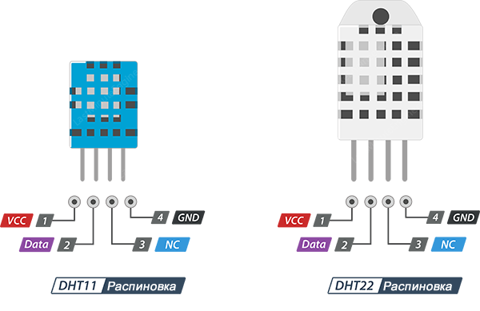
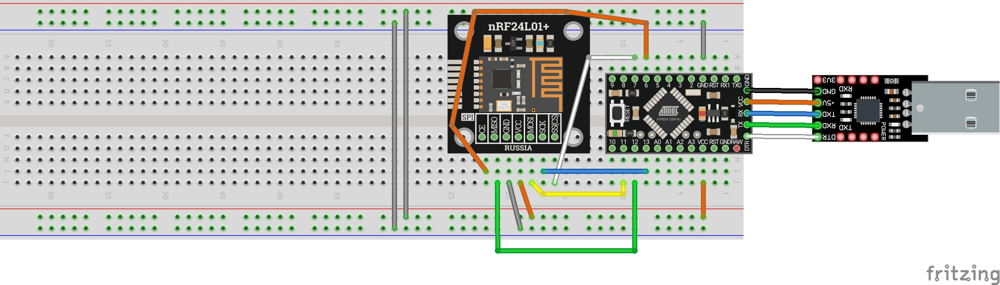

## [KvizzyVid17base](#)

### [Как работать с nrf24l01 через PiranhaProMini](#)

#### [Подключение nrf24l01](#)




Модуль nRF24L01 общается по интерфейсу SPI, поэтому нужно соединить соответствующие пины по следующей схеме:

```
VCC модуля              → 3.3 В   на PiranhaProMini;
GND модуля              → GND     на PiranhaProMini;
CE (Chip Enable) модуля → GPIO6   оранжевый;
CSN (Chip Select Not, активен низкий уровень для SPI) модуля 
                        → GPIO7   белый;
MISO модуля             → GPIO12  зеленый;
MOSI модуля             → GPIO11  желтый;
SCK модуля              → GPIO13  синий;
```

Конденсатор. Для стабильной работы параллельно пинам VCC и GND модуля nRF24L01 желательно поставить конденсатор ёмкостью около 10 мкФ. Он сгладит скачки напряжения и уменьшит помехи.


***Ключевой момент:***  адрес трубы (`openWritingPipe` и `openReadingPipe`) должен совпадать на обоих модулях. Это главное условие для успешной связи.

#### Решение частых проблем

- ***Не работает связь.*** Проверьте правильность физического подключения. Убедитесь, что адреса (трубы) на передатчике и приёмнике совпадают. Проверьте стабильность питания модуля.

- ***Потери пакетов.*** Радиотракт nRF24L01 чувствителен к помехам. Попробуйте использовать экранированный кабель или обернуть плату модуля фольгой (не изолентой!). Также можно поэкспериментировать со скоростью передачи данных и уровнем мощности (PA).

- ***Нестабильная работа при нескольких модулях.*** Иногда проблема в том, что при одновременном обмене данными с несколькими устройствами возникает конфликт. Попробуйте изменить адреса труб или отключить автоматическую отправку подтверждений (`autoAck`).

#### [Подключение датчика DHT11 к Ардуино](https://robotclass.ru/tutorials/arduino-dht/?ysclid=mvtqec8crx792409395)





Характеристики датчика

```
напряжение питания и I/O:              от 3,3 до 5,5 В;
тип датчика влажности:                 резистивный;
диапазон измерения влажности:          от 20% до 90%;
погрешность при измерении влажности:   5%;
тип датчика температуры:               NTC термистор;
диапазон измерения температуры:        от 0°C до 50°C;
погрешность при измерении температуры: 2%;
частота опроса:                        не более 1 Гц (1 раз в сек.);
время отклика при измерении влажности: 10 с.
```

Кроме DHT-11, существует множество аналогичных датчиков, которые отличаются точностью, энергопотреблением, интерфейсом. 

> ***Например, у датчика DHT22 диапазон измерений влажности составляет от 0 до 100%, а температуры от -40 до 125°C.***

#### Общая схема



