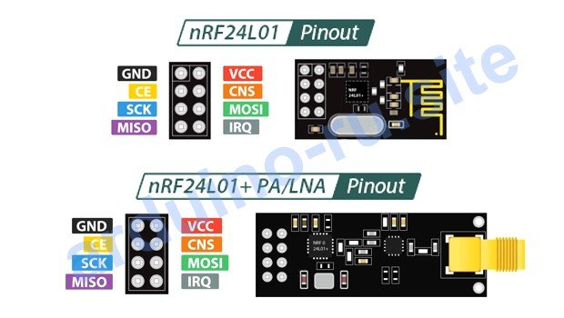
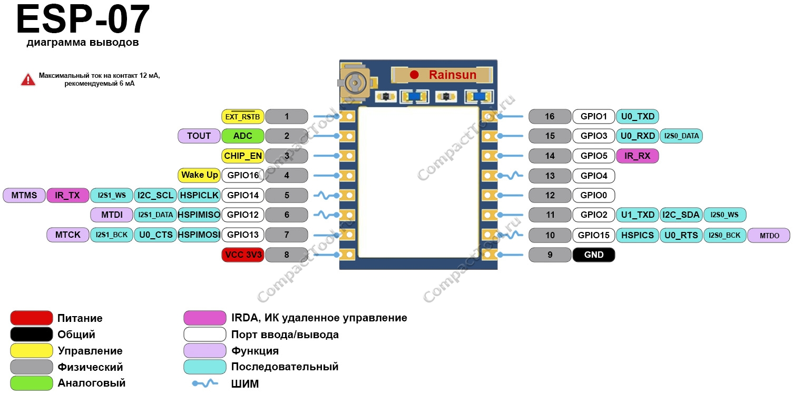

## [KvizzyVid17flat](#)

### [Как работать с nrf24l01 через esp07](#)

#### Физическое подключение





Модуль nRF24L01 общается по интерфейсу SPI, поэтому нужно соединить соответствующие пины по следующей схеме:

```
VCC модуля              → 3.3 В на ESP07;
GND модуля              → GND   на ESP07;
CE (Chip Enable) модуля → GPIO4 на ESP07;
CSN (Chip Select Not, активен низкий уровень для SPI) модуля 
                        → GPIO5 на ESP07;
MISO модуля             → GPIO12.
MOSI модуля             → GPIO13;
SCK модуля              → GPIO14;
```

Важное предупреждение: не подавайте на модуль 5 В — его рабочее напряжение 1,9–3,6 В, и высокое напряжение может сжечь чип. 

Конденсатор. Для стабильной работы параллельно пинам VCC и GND модуля nRF24L01 желательно поставить конденсатор ёмкостью около 10 мкФ. Он сгладит скачки напряжения и уменьшит помехи.

#### Написание кода

В роли приёмника ESP07, а передатчиком может быть Arduino или другой ESP8266.

***Передатчик:***

```
#include <SPI.h>
#include <RF24.h>

RF24 radio(--4, --15); // Пины CSN и CE

void setup() 
{
  Serial.begin(115200);
  while (!Serial);

  radio.begin();
  radio.setChannel(0x6f); // Устанавливаем канал
  radio.openWritingPipe(0x0123456789LL); // Открываем трубу для записи (адрес должен совпадать с приёмником!)
}

void loop()
{
  if (radio.available()) 
  {
    uint8_t data;
    uint8_t size = radio.read(data, sizeof(data));
    Serial.println("Получено:");
    for (int i = 0; i < size; i++) 
    {
      Serial.print(data[i]);
    }
    Serial.println();
    radio.write(data, size); // Отправляем данные обратно (подтверждение)
  }
}
```

***Приёмник:***

```
#include <SPI.h>
#include <RF24.h>

RF24 radio(--4, --15); // Пины CSN и CE

void setup() 
{
  Serial.begin(115200);
  while (!Serial);

  radio.begin();
  radio.openReadingPipe(0x0123456789LL); // Тот же адрес, что и у передатчика!
  radio.startListening();
}

void loop()
{
  if (radio.available())
  {
    uint8_t data;
    uint8_t size = radio.read(data, sizeof(data));
    Serial.println("Получено:");
    for (int i = 0; i < size; i++) 
    {
      Serial.print(data[i]);
    }
    Serial.println();
  }
}
```

***Ключевой момент:***  адрес трубы (`openWritingPipe` и `openReadingPipe`) должен совпадать на обоих модулях. Это главное условие для успешной связи.

#### Решение частых проблем

- ***Не работает связь.*** Проверьте правильность физического подключения. Убедитесь, что адреса (трубы) на передатчике и приёмнике совпадают. Проверьте стабильность питания модуля.

- ***Потери пакетов.*** Радиотракт nRF24L01 чувствителен к помехам. Попробуйте использовать экранированный кабель или обернуть плату модуля фольгой (не изолентой!). Также можно поэкспериментировать со скоростью передачи данных и уровнем мощности (PA).

- ***Нестабильная работа при нескольких модулях.*** Иногда проблема в том, что при одновременном обмене данными с несколькими устройствами возникает конфликт. Попробуйте изменить адреса труб или отключить автоматическую отправку подтверждений (`autoAck`).

Начните с простого проекта «точка-точка».

### [Какие ещё библиотеки можно использовать с nRF24L01?](#)

Помимо RF24, действительно есть и другие варианты. 

#### Mirf. 

Это прямая альтернатива RF24. Многие считают её более «голой» и низкоуровневой: она даёт больше контроля над регистром модуля, но из-за этого код может быть чуть сложнее для новичка. Зато в ней есть удобные фишки вроде автоматической отправки заготовленного ответа в ответ на запрос — это полезно, например, при опросе датчиков. 

#### nrf24l01 (от junon10). 

Эта библиотека сделана с упором на простоту и низкое потребление памяти. Если вы работаете с ограниченным ресурсом (например, с очень лёгкой версией ESP01), этот вариант может быть выгоднее. В ней есть базовые функции для настройки канала, адресов и передачи данных. 

#### RadioHead (конкретно драйвер RH_NRF24). 

RadioHead — это более общая библиотека для радиомодулей, и в ней есть отдельный драйвер для nRF24. Её стоит рассмотреть, если вы планируете в будущем расширять проект: она поддерживает и другие типы радиомодулей, и позволяет строить более сложные сети. Плюс в ней есть дополнительные возможности, например, поддержка шифрования. 

#### SerialFlow. 

Важно сразу оговориться: сама по себе SerialFlow не заменяет драйвер SPI (вроде RF24 или Mirf) — она работает поверх него. Её задача — упростить работу с пакетами: задать их формат, написать функции для упаковки данных перед отправкой и распаковки после приёма. Если вы часто передаёте сложные структуры данных (например, показания нескольких датчиков одним пакетом), эта библиотека сильно сэкономит время. 

#### RF24Mesh. 

Если ваша задача — создать не простую пару «передатчик-приёмник», а настоящую mesh-сеть (когда данные могут идти по разным маршрутам, подключая несколько устройств), обратите внимание на эту библиотеку. Она поддерживает до 255 устройств в сети.

#### RF24Network. 

Ещё один инструмент для построения mesh-сетей на базе nRF24L01.

#### Практический совет

Когда переключаетесь с одной библиотеки на другую, будьте внимательны: синтаксис функций может отличаться. Перед тем как писать сложный код, найдите готовый пример для вашей платформы (ESP01) и поэкспериментируйте с ним. 

### [Как проверить стабильность связи nRF24L01 и ESP8266?](#)

Чтобы проверить стабильность связи между nRF24L01 и ESP8266 (ESP‑01), нужно не просто «отправить один пакет», а собрать небольшой тестовый протокол с метриками. Ниже — рабочие способы от простого к продвинутому, плюс типичные подводные камни именно для связки ESP8266 + nRF24L01.

#### Быстрый старт: проверка «есть связь или нет»

Самый простой тест — запустить на передатчике отправку счётчика, а на приёмнике — вывод в Serial. Если видите последовательные числа без пропусков — базовая связь есть.

Передатчик (ESP8266):

```
#include <SPI.h>
#include <RF24.h>

RF24 radio(4, 15); // CE, CSN
const uint64_t pipe = 0xE8E8F0F0E1LL;

void setup() 
{
  Serial.begin(115200);
  radio.begin();
  radio.openWritingPipe(pipe);
  radio.setPALevel(RF24_PA_HIGH);
  radio.setDataRate(RF24_250KBPS); // 250 кбит/с стабильнее на дистанции
}

void loop() 
{
  static uint32_t counter = 0;
  counter++;
  if (radio.write(&counter, sizeof(counter))) 
  {
    Serial.print("Sent: ");
    Serial.println(counter);
  } 
  else 
  {
    Serial.println("Send failed");
  }
  delay(200); // 5 пакетов в секунду — удобно считать потери
}
```

Приёмник (ESP8266 или другая плата):

```
#include <SPI.h>
#include <RF24.h>

RF24 radio(4, 15);
const uint64_t pipe = 0xE8E8F0F0E1LL;
uint32_t lastCounter = 0;
uint32_t missed = 0;

void setup() 
{
  Serial.begin(115200);
  radio.begin();
  radio.openReadingPipe(1, pipe);
  radio.startListening();
  radio.setPALevel(RF24_PA_HIGH);
  radio.setDataRate(RF24_250KBPS);
}

void loop() 
{
  if (radio.available())
  {
    uint32_t received;
    radio.read(&received, sizeof(received));

    if (received == lastCounter + 1) 
    {
      // Ок, без потерь
    } 
    else if (received > lastCounter) 
    {
      missed += (received - lastCounter - 1);
      Serial.print("Missed packets: ");
      Serial.println(missed);
    } 
    else 
    {
      // Переполнение счётчика или рассинхронизация — сброс
      missed = 0;
    }
    lastCounter = received;

    Serial.print("Got: ");
    Serial.print(received);
    Serial.print(", missed total: ");
    Serial.println(missed);
  }
} 
```
Если видите пропуски — это уже количественная оценка нестабильности.

#### Как объективно измерить стабильность

Используйте эти метрики:

Процент потерь пакетов = (пропущенные номера) / (всего отправленных) за фиксированное время.

Максимальная задержка между пакетами — если пакеты приходят «пачками» с большими паузами, это признак нестабильного SPI или питания.

Количество повторных передач (retries) — библиотека RF24 умеет считать их, если включить setRetries.

Пример включения подсчёта ретраев:

```
radio.setRetries(15, 15); // max retries, delay
// После write() можно смотреть radio.lastResult() и 
// анализировать статус
```

Для полноценного теста запускайте передачу минимум 5–10 минут и смотрите, как растёт счётчик пропущенных пакетов.

Продвинутый тест: пинг-пакет с временем

Чтобы оценить задержки, отправляйте структуру с таймстемпом:

```
struct Packet 
{
  uint32_t seq;
  uint32_t ts_send;
};
```

Приёмник фиксирует ts_receive = micros() и выводит latency = ts_receive - ts_send. Так вы увидите не только потери, но и джиттер (разброс задержек).

#### Важные нюансы именно для ESP8266 + nRF24L01

- Питание — главная причина нестабильности. nRF24L01 потребляет импульсные пики до 15–20 мА при передаче. ESP8266 тоже «просаживает» питание при Wi‑Fi. Без конденсатора 10–47 мкФ прямо на пинах VCC/GND модуля связь будет рваться.

- Скорость SPI. На ESP8266 программный SPI может быть медленным. Для стабильности ставьте setDataRate(RF24_250KBPS) — это снижает требования к качеству линии.

- Длина проводов. Длинные перемычки и «макетка» дают наводки. Чем короче провода и чем ближе модуль к плате — тем лучше.

- Конфликт Wi‑Fi и SPI. ESP8266 активно использует шину для Wi‑Fi. Если связь пропадает при активном Wi‑Fi — попробуйте временно отключить Wi‑Fi в тесте или уменьшить частоту опроса.

- Пины. На ESP‑01 мало свободных GPIO. CE/CSN лучше вешать на GPIO4/GPIO15, остальные — по SPI. Избегайте GPIO0/GPIO2 при работе (они участвуют в загрузке).

#### Практический чек‑лист для проверки стабильности

- Соберите схему с конденсатором на модуле.
- Запустите тест со счётчиком на 5–10 минут.
- Запишите процент потерь и максимальный разрыв последовательности.
- Повторите тест на разных расстояниях (1 м, 3 м, 5 м) и в разных условиях (рядом с роутером, в другой комнате).
- Попробуйте разные настройки: RF24_250KBPS vs 1MBPS, разные уровни мощности (PA_LOW, PA_HIGH).
- Если потери высокие — проверьте питание (осциллографом или хотя бы мультиметром на просадку) и длину проводов.

#### Альтернативные библиотеки для диагностики

***RF24Network (надстройка над RF24)*** — даёт адресацию и простой механизм подтверждения доставки.

***RF24Mesh*** — если планируете сеть из нескольких узлов, там уже есть встроенные метрики качества связи. Они не упрощают сам тест, но дают готовые инструменты для оценки надёжности.

#### Тестовый скетч для оценки стабильности

Напишите скетч, который будет непрерывно передавать данные с фиксированной частотой (например, каждые 100 мс) и подсчитывать количество успешно принятых пакетов за определённый промежуток времени.

Пример кода для передатчика:

```
#include <SPI.h>
#include <nRF24L01.h>
#include <RF24.h>

RF24 radio(2, 15); // CSN, CE

void setup()
{
  Serial.begin(9600);
  radio.begin();
  radio.setAutoAck(0);
}

void loop() 
{
  radio.writeFast(&id, sizeof(id)); // Передача данных
  delay(100); // Интервал передачи
}
```

Пример кода для приёмника:

```
#include <SPI.h>
#include <nRF24L01.h>
#include <RF24.h>

RF24 radio(2, 15); // CSN, CE

void setup() 
{
  Serial.begin(9600);
  radio.begin();
  radio.setAutoAck(0);
  radio.startListening();
}

void loop() 
{
  if (radio.available()) 
  {
    byte payload;
    uint8_t size = radio.readPayload(payload, sizeof(payload), 0);
    Serial.println(String(size) + " bytes received");
  }
  delay(100);
}
``` 
#### Что анализировать в результатах:

- ***Количество повторных передач (retries):*** если пакет не доходит до приёмника, он может бесконечно повторяться.

- ***Таймауты:*** если функция `radio.writeFast()` или `radio.startListening()` зависает, это указывает на проблемы с соединением или загрузкой прошивки.

- ***Стабильность частоты ошибок (Error Count):*** посчитайте, сколько раз за минуту система фиксирует потерю пакета.

#### Оцените влияние внешних факторов

Стабильность сильно зависит от условий эксплуатации. Проведите тесты в разных сценариях:

- ***На разных расстояниях.*** Удалите модули друг от друга и проверьте, как меняется стабильность при приближении/удалении.

- ***В разных помехах.*** Поместите между модулями металлические предметы или источники помех (например, Wi-Fi-роутер) и оцените, как это сказывается на приёме.

- ***При разных погодных условиях.*** Влажность, температура и уровень помех в эфире тоже играют роль.

### [Как усилить передачу и прием nrf24L01](#)

Чтобы усилить передачу и приём сигнала у модуля nRF24L01, можно действовать на двух уровнях: программно и аппаратно. 

#### Программные методы

1. Настройка уровня мощности передатчика (PA). В библиотеке RF24 для этого используется функция setPALevel(). Доступные уровни: RF24_PA_MIN (минимальная мощность), RF24_PA_HIGH и RF24_PA_MAX (максимальная).

Пример кода для передатчика:

```
radio.setPALevel(RF24_PA_HIGH); // Устанавливаем высокий уровень мощности
```

Важно: установка максимального уровня (RF24_PA_MAX) не всегда безопасна. В некоторых случаях модуль может перестать нормально принимать сигнал. Начинайте с RF24_PA_MIN и постепенно увеличивайте мощность, наблюдая за стабильностью связи.

2. Выбор скорости передачи данных. Чем ниже скорость, тем выше чувствительность приёмника. Можно использовать константы: RF24_1MBPS (1 Мбит/с) или RF24_250KBPS (250 Кбит/с).

Пример:

```
radio.setDataRate(RF24_250KBPS); // Медленная скорость для лучшей чувствительности
```

3. Оптимизация протокола связи. Используйте протокол Enhanced ShockBurst, который автоматически повторяет отправку пакета при отсутствии подтверждения. Также можно настроить количество попыток повторной отправки (setRetries()) и интервал между ними.

4. Отключение лишних функций. Отключение автоматической отправки подтверждения (ACK) и CRC может повысить стабильность, но это увеличивает риск потери пакетов. Если связь нестабильна, попробуйте отключить автоACK и контролировать приём самостоятельно.

5. Использование нескольких каналов (труб). Это позволяет одновременно работать нескольким парам передатчик-приёмник на разных частотных каналах, избегая помех.

#### Аппаратные методы

1. Использование модулей с PA и LNA. Существуют специализированные версии nRF24L01+, оснащённые встроенным усилителем мощности (PA) и усилителем низкой частоты (LNA) на приёмнике. Это даёт значительный прирост дальности как при передаче, так и при приёме.

Модификации вроде nRF24L01+PA+LNA оснащены отдельными усилителями: PA (Power Amplifier) увеличивает мощность передатчика, а LNA (Low-Noise Amplifier) повышает чувствительность приёмника, улавливая слабые сигналы. Это даёт значительный прирост дальности (до 1000 метров).

2. Улучшение питания. Нестабильное питание — частая причина проблем с дальностью. Параллельно пинам питания модуля рекомендуется припаять конденсаторы (электролитические и керамические) для стабилизации напряжения.

3. Внешняя антенна. Встроенная антенна у nRF24L01 довольно слабая. Подключение более мощной внешней антенны (например, SMA-разъёма) заметно улучшает дальность и стабильность связи.

4. Оптимизация антенны. Качество антенны напрямую влияет на дальность. Для nRF24L01 лучше подходят внешние антенны с высоким коэффициентом усиления (например, патч-антенны), а не встроенные на модуле. Также важно обеспечить хороший контакт антенны с землёй.

5. Ретрансляторы. Для значительного увеличения дальности можно использовать промежуточные узлы-ретрансляторы. Важно правильно настроить задержки между пакетами, чтобы ретранслятор успевал принимать и пересылать данные.

6. Проверка и оптимизация. Для точной настройки используйте анализатор спектра или логический анализатор, чтобы оценить качество сигнала на разных уровнях мощности и скоростях.

7. Избегание помех. Выбирайте свободный частотный канал (избегайте каналов с активным вещанием) и старайтесь минимизировать препятствия между устройствами.
Используйте ретрансляторы. Это промежуточный узел, который принимает сигнал и пересылает его дальше. Важно правильно настроить задержки, чтобы ретранслятор успевал обработать пакет.

8. Подготовка соединений. Плохой контакт в пайке или окисленные контакты могут имитировать проблемы с дальностью.

### [Esp8266-and-nrf24L01](https://www.teachmemicro.com/esp8266-nrf24l01-interfacing/)


В этом руководстве мы рассмотрим, как подключить ESP8266 к беспроводному модулю nRF24L01. nRF24L01 — это маломощный модуль беспроводного приемопередатчика с частотой 2,4 ГГц, который обычно используется для беспроводной связи на коротких расстояниях. Он взаимодействует по протоколу SPI, а ESP8266 — это микроконтроллер с поддержкой Wi-Fi, который можно программировать с помощью Arduino IDE.


Мы рассмотрим пример проекта, в котором ESP8266 взаимодействует с другим модулем nRF24L01, обеспечивая беспроводную передачу данных.

#### Подключение ESP8266 и nRF24L01
```
nRF24L01 использует SPI для связи с ESP8266. Распиновка обоих устройств следующая:

nRF24L01
---------
VCC:  3.3V
GND:  Ground
CE:   Chip Enable (used to set the module in active mode)
CSN:  Chip Select Not (active low, for SPI communication)
SCK:  SPI Clock
MOSI: Master Out Slave In (SPI data line)
MISO: Master In Slave Out (SPI data line)
IRQ:  Interrupt 

ESP8266 (NodeMCU/ESP-12E)
--------------------------
nRF24L01 VCC  → ESP8266 3.3V
nRF24L01 GND  → ESP8266 GND
nRF24L01 CE   → ESP8266 GPIO4 (D2)
nRF24L01 CSN  → ESP8266 GPIO15 (D8)
nRF24L01 SCK  → ESP8266 GPIO14 (D5)
nRF24L01 MOSI → ESP8266 GPIO13 (D7)
nRF24L01 MISO → ESP8266 GPIO12 (D6)
```

Для установки пакета платы ESP8266:

```
http://arduino.esp8266.com/stable/package_esp8266com_index.json
```

Код передатчика для ESP8266:

```
#include <SPI.h>
#include <RF24.h>

// Define nRF24L01 pins
#define CE_PIN 4   // GPIO4  (D2)
#define CSN_PIN 15 // GPIO15 (D8)

// Create an RF24 object
RF24 radio(CE_PIN, CSN_PIN);

// Define the address (must match on both transmitter and receiver)
const byte address[6] = "00001";

// Data to send
const char text[] = "Hello from ESP8266!";

void setup() {
  // Start the serial communication for debugging
  Serial.begin(115200);

  // Initialize the radio
  radio.begin();
  
  // Set the communication address
  radio.openWritingPipe(address);
  
  // Set the data rate and power level (can be adjusted for range)
  radio.setPALevel(RF24_PA_LOW);
  radio.setDataRate(RF24_1MBPS);

  // Ensure radio is in transmit mode
  radio.stopListening();
}

void loop() {
  // Send the data
  bool success = radio.write(&text, sizeof(text));

  // Check if data was sent successfully
  if (success) {
    Serial.println("Data sent successfully");
  } else {
    Serial.println("Failed to send data");
  }

  // Delay before sending the next data
  delay(1000);
}
```

Код приемника (Arduino/ESP8266). В качестве приемника данных можно использовать Arduino или другой ESP8266. Подключение nRF24L01 останется прежним:

```
#include <SPI.h>
#include <RF24.h>

#define CE_PIN 9   // Use appropriate pin for your board
#define CSN_PIN 10 // Use appropriate pin for your board

RF24 radio(CE_PIN, CSN_PIN);
const byte address[6] = "00001";
char receivedText[32] = ""; // Buffer to hold received data

void setup() {
  Serial.begin(9600);
  radio.begin();
  radio.openReadingPipe(0, address);
  radio.setPALevel(RF24_PA_LOW);
  radio.setDataRate(RF24_1MBPS);
  radio.startListening();
}

void loop() {
  if (radio.available()) {
    radio.read(&receivedText, sizeof(receivedText));
    Serial.print("Received data: ");
    Serial.println(receivedText);
  }
}

```


