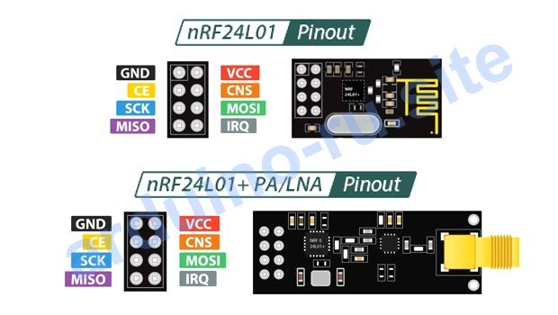

## [KvizzyVid17flat - промежуточный уровень](#)

```
CONFIGURATION: https://docs.platformio.org/page/boards/espressif32/nodemcu-32s.html
PLATFORM: Espressif 32 (8.0.0) > NodeMCU-32S
HARDWARE: ESP32 240MHz, 320KB RAM, 4MB Flash
```
Для схемы взято распределение памяти без OTA с выделением под код ***3 145 728*** байта - ***[huge_app.csv](huge_app.csv)*** :

```
------------------------------------------
Partitions Info:   huge_app.csv
------------------------------------------
# Name,   Type, SubType, Offset,  Size, Flags
nvs,      data, nvs,     0x9000,  0x5000,
otadata,  data, ota,     0xe000,  0x2000,
app0,     app,  ota_0,   0x10000, 0x300000,
spiffs,   data, spiffs,  0x310000,0xE0000,
coredump, data, coredump,0x3F0000,0x10000,
------------------------------------------
                nvs : addr: 0x00009000, size:    20.0 KB, type: DATA, subtype: NVS
            otadata : addr: 0x0000E000, size:     8.0 KB, type: DATA, subtype: OTA
               app0 : addr: 0x00010000, size:  3072.0 KB, type:  APP, subtype: OTA_0
             spiffs : addr: 0x00310000, size:   896.0 KB, type: DATA, subtype: SPIFFS
           coredump : addr: 0x003F0000, size:    64.0 KB, type: DATA, subtype: COREDUMP
------------------------------------------
```


Модуль nRF24L01 общается по интерфейсу SPI, поэтому нужно соединить соответствующие пины по следующей схеме:

```
VCC модуля                       → 3.3 В   на контроллере ESP32;
GND модуля                       → GND     на контроллере ESP32;

MISO модуля                      → GPIO19  фиолетовый;
SCK модуля                       → GPIO18  коричневый;
CSN (активен низкий уровень SPI) → GPIO5   синий;

CE (Chip Enable) модуля          → GPIO22  желтый;
MOSI модуля                      → GPIO23  зелёный;
```

Конденсатор. Для стабильной работы параллельно пинам VCC и GND модуля nRF24L01 желательно поставить конденсатор ёмкостью около 10 мкФ. Он сгладит скачки напряжения и уменьшит помехи.



